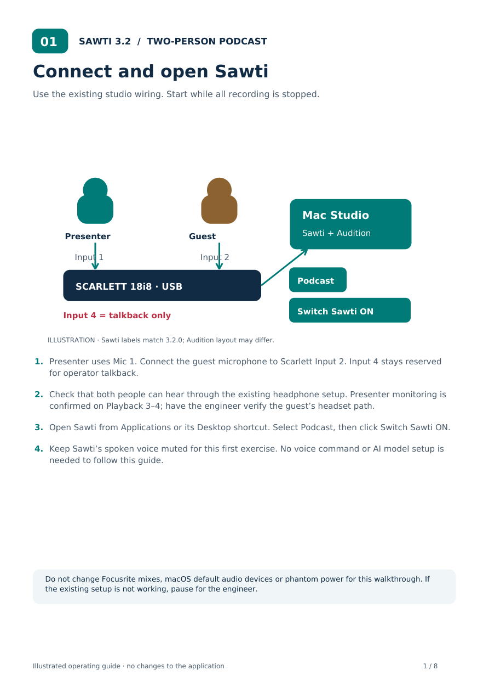
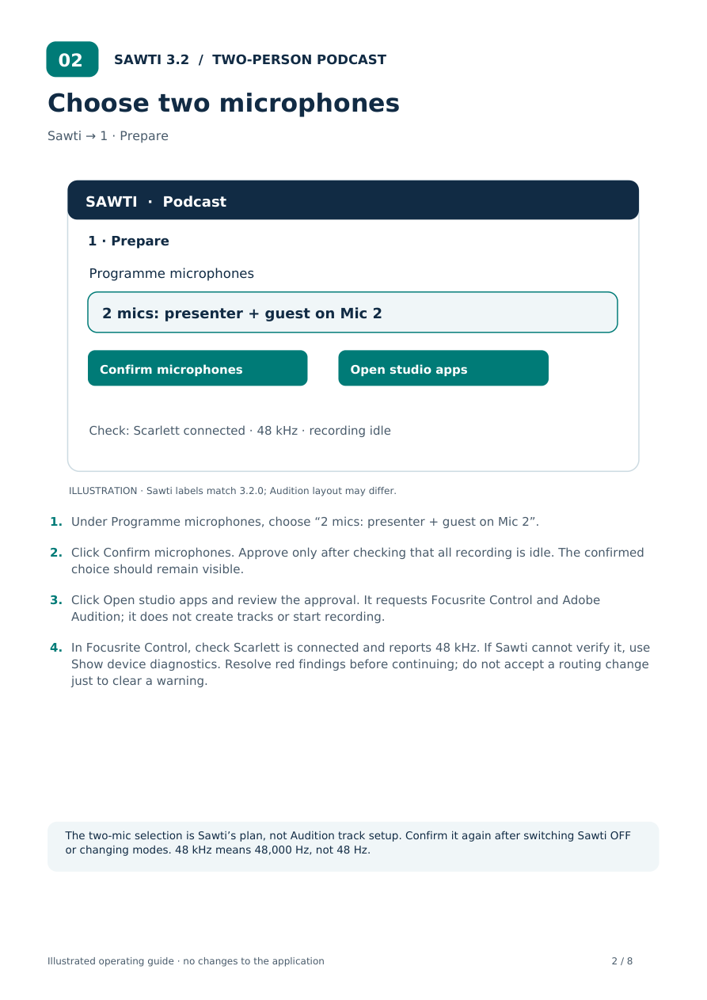
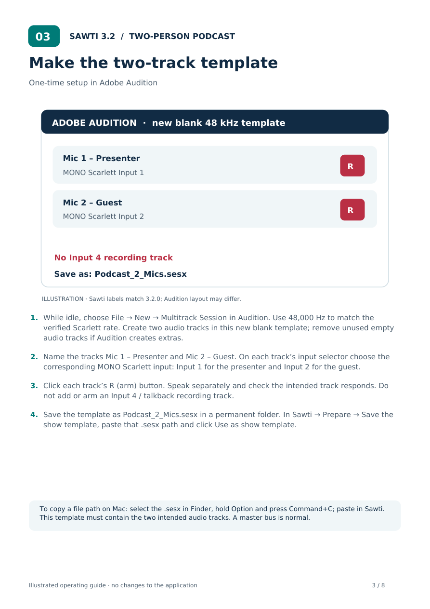
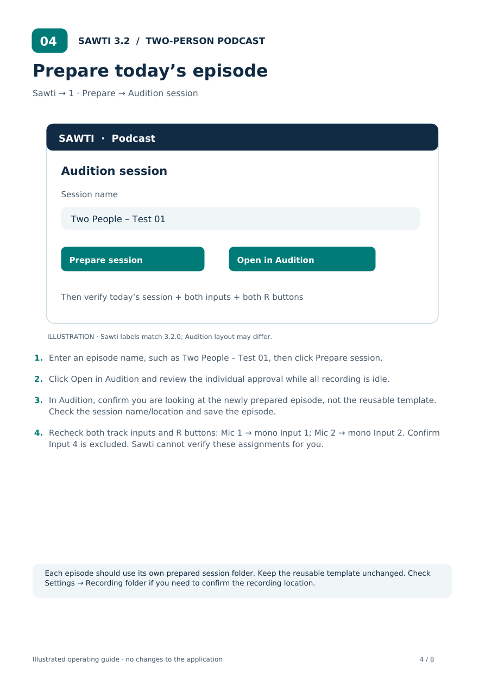
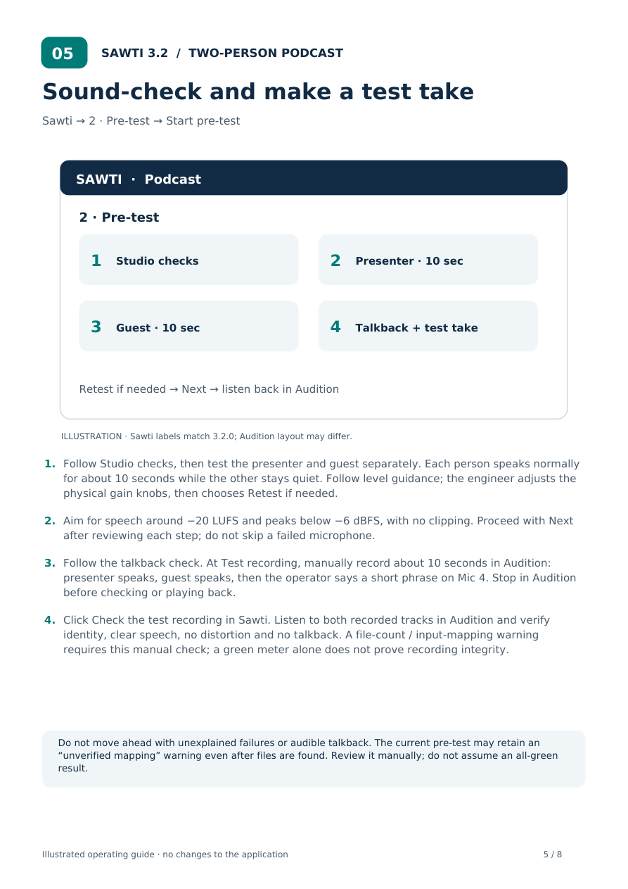
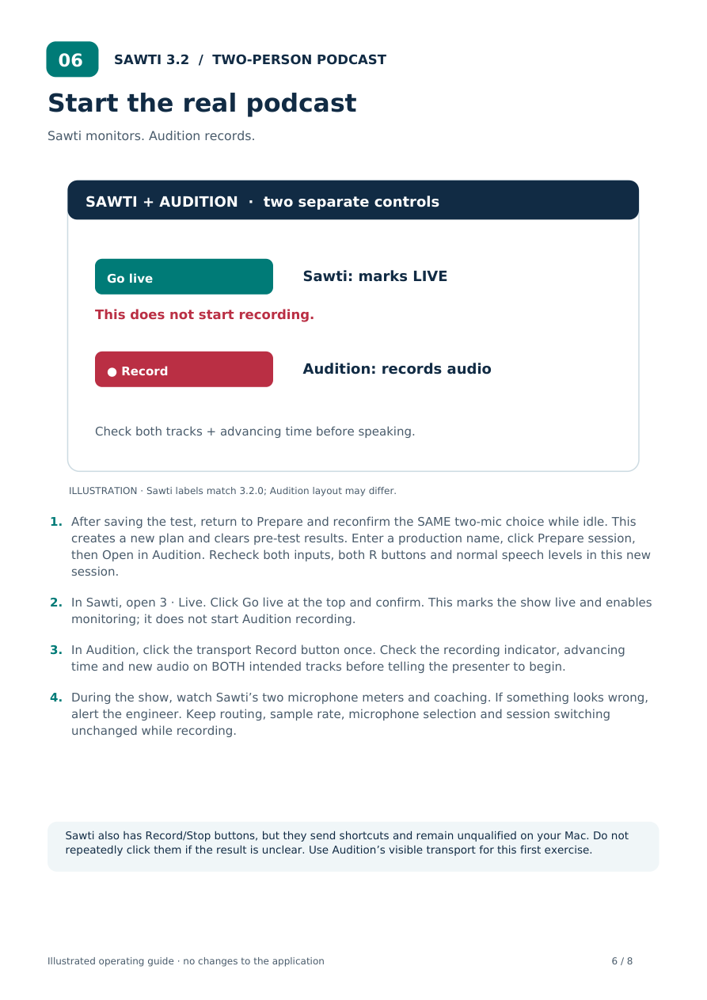
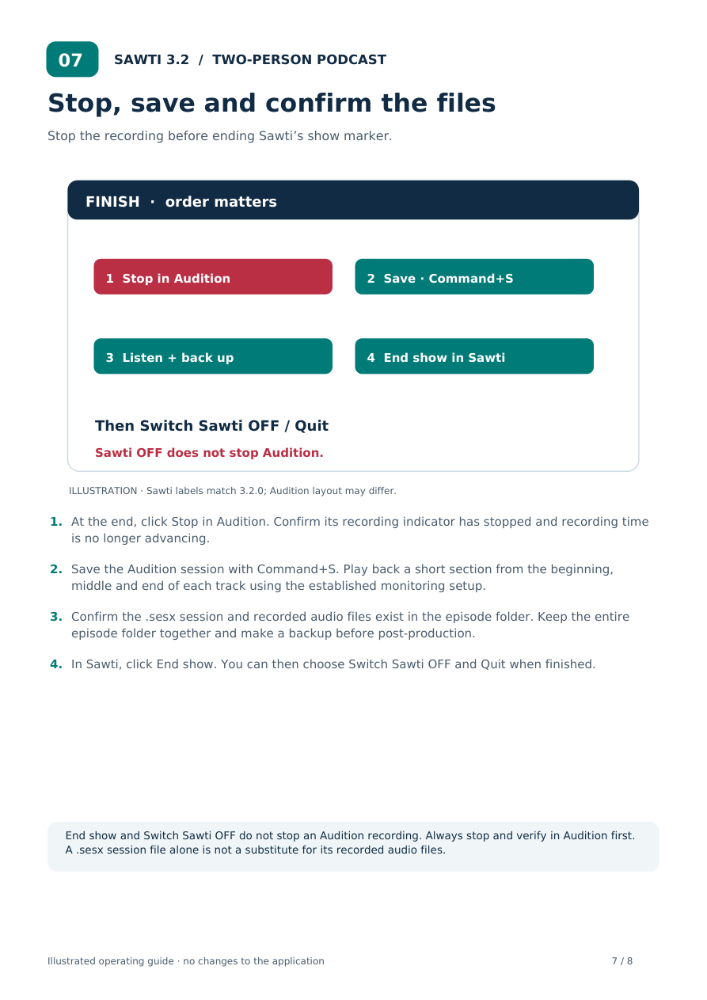
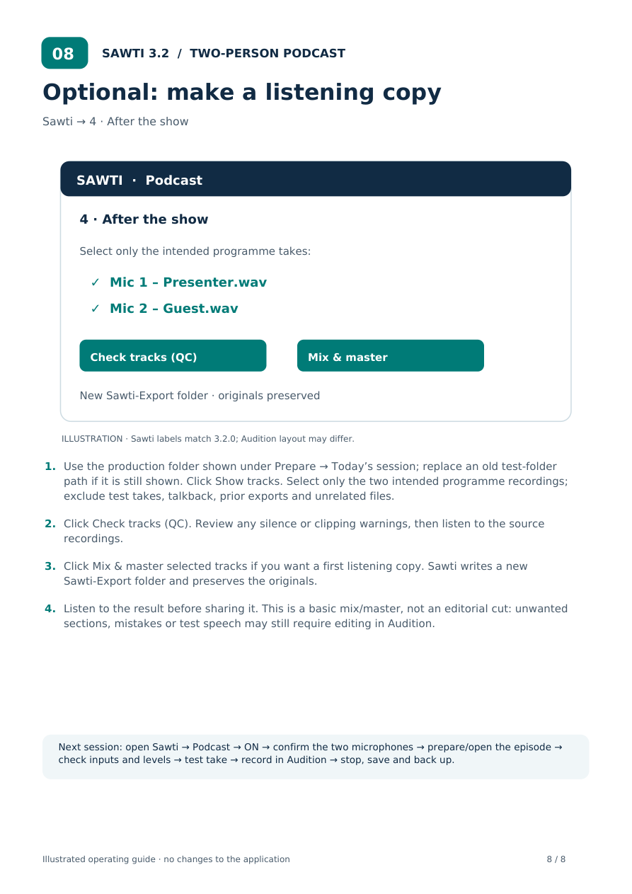

# Two-person podcast with Sawti 3.2.0

Presenter on **Mic 1**, guest on **Mic 2**, input 4 reserved for operator talkback. This first run uses buttons; a spoken automatic test/countdown/record sequence is not implemented.

[Download the printable illustrated guide](Sawti-3.2-Two-Person-Podcast-Guide.pdf)

Pictures are illustrations based on current button labels, not screenshots or evidence of validation on your Mac. Audition layouts vary. The current build cannot verify Audition track mapping or transport; check those in Audition.

## 1. Connect and open Sawti

Use the existing studio wiring. Start while all recording is stopped.

1. Presenter uses Mic 1. Connect the guest microphone to Scarlett Input 2. Input 4 stays reserved for operator talkback.
2. Check that both people can hear through the existing headphone setup. Presenter monitoring is confirmed on Playback 3–4; have the engineer verify the guest’s headset path.
3. Open Sawti from Applications or its Desktop shortcut. Select Podcast, then click Switch Sawti ON.
4. Keep Sawti’s spoken voice muted for this first exercise. No voice command or AI model setup is needed to follow this guide.

**Check:** Do not change Focusrite mixes, macOS default audio devices or phantom power for this walkthrough. If the existing setup is not working, pause for the engineer.

## 2. Choose two microphones

Sawti → 1 · Prepare

1. Under Programme microphones, choose “2 mics: presenter + guest on Mic 2”.
2. Click Confirm microphones. Approve only after checking that all recording is idle. The confirmed choice should remain visible.
3. Click Open studio apps and review the approval. It requests Focusrite Control and Adobe Audition; it does not create tracks or start recording.
4. In Focusrite Control, check Scarlett is connected and reports 48 kHz. If Sawti cannot verify it, use Show device diagnostics. Resolve red findings before continuing; do not accept a routing change just to clear a warning.

**Check:** The two-mic selection is Sawti’s plan, not Audition track setup. Confirm it again after switching Sawti OFF or changing modes. 48 kHz means 48,000 Hz, not 48 Hz.

## 3. Make the two-track template

One-time setup in Adobe Audition

1. While idle, choose File → New → Multitrack Session in Audition. Use 48,000 Hz to match the verified Scarlett rate. Create two audio tracks in this new blank template; remove unused empty audio tracks if Audition creates extras.
2. Name the tracks Mic 1 – Presenter and Mic 2 – Guest. On each track’s input selector choose the corresponding MONO Scarlett input: Input 1 for the presenter and Input 2 for the guest.
3. Click each track’s R (arm) button. Speak separately and check the intended track responds. Do not add or arm an Input 4 / talkback recording track.
4. Save the template as Podcast_2_Mics.sesx in a permanent folder. In Sawti → Prepare → Save the show template, paste that .sesx path and click Use as show template.

**Check:** To copy a file path on Mac: select the .sesx in Finder, hold Option and press Command+C; paste in Sawti. This template must contain the two intended audio tracks. A master bus is normal.

## 4. Prepare today’s episode

Sawti → 1 · Prepare → Audition session

1. Enter an episode name, such as Two People – Test 01, then click Prepare session.
2. Click Open in Audition and review the individual approval while all recording is idle.
3. In Audition, confirm you are looking at the newly prepared episode, not the reusable template. Check the session name/location and save the episode.
4. Recheck both track inputs and R buttons: Mic 1 → mono Input 1; Mic 2 → mono Input 2. Confirm Input 4 is excluded. Sawti cannot verify these assignments for you.

**Check:** Each episode should use its own prepared session folder. Keep the reusable template unchanged. Check Settings → Recording folder if you need to confirm the recording location.

## 5. Sound-check and make a test take

Sawti → 2 · Pre-test → Start pre-test

1. Follow Studio checks, then test the presenter and guest separately. Each person speaks normally for about 10 seconds while the other stays quiet. Follow level guidance; the engineer adjusts the physical gain knobs, then chooses Retest if needed.
2. Aim for speech around −20 LUFS and peaks below −6 dBFS, with no clipping. Proceed with Next after reviewing each step; do not skip a failed microphone.
3. Follow the talkback check. At Test recording, manually record about 10 seconds in Audition: presenter speaks, guest speaks, then the operator says a short phrase on Mic 4. Stop in Audition before checking or playing back.
4. Click Check the test recording in Sawti. Listen to both recorded tracks in Audition and verify identity, clear speech, no distortion and no talkback. A file-count / input-mapping warning requires this manual check; a green meter alone does not prove recording integrity.

**Check:** Do not move ahead with unexplained failures or audible talkback. The current pre-test may retain an “unverified mapping” warning even after files are found. Review it manually; do not assume an all-green result.

## 6. Start the real podcast

Sawti monitors. Audition records.

1. After saving the test, return to Prepare and reconfirm the SAME two-mic choice while idle. This creates a new plan and clears pre-test results. Enter a production name, click Prepare session, then Open in Audition. Recheck both inputs, both R buttons and normal speech levels in this new session.
2. In Sawti, open 3 · Live. Click Go live at the top and confirm. This marks the show live and enables monitoring; it does not start Audition recording.
3. In Audition, click the transport Record button once. Check the recording indicator, advancing time and new audio on BOTH intended tracks before telling the presenter to begin.
4. During the show, watch Sawti’s two microphone meters and coaching. If something looks wrong, alert the engineer. Keep routing, sample rate, microphone selection and session switching unchanged while recording.

**Check:** Sawti also has Record/Stop buttons, but they send shortcuts and remain unqualified on your Mac. Do not repeatedly click them if the result is unclear. Use Audition’s visible transport for this first exercise.

## 7. Stop, save and confirm the files

Stop the recording before ending Sawti’s show marker.

1. At the end, click Stop in Audition. Confirm its recording indicator has stopped and recording time is no longer advancing.
2. Save the Audition session with Command+S. Play back a short section from the beginning, middle and end of each track using the established monitoring setup.
3. Confirm the .sesx session and recorded audio files exist in the episode folder. Keep the entire episode folder together and make a backup before post-production.
4. In Sawti, click End show. You can then choose Switch Sawti OFF and Quit when finished.

**Check:** End show and Switch Sawti OFF do not stop an Audition recording. Always stop and verify in Audition first. A .sesx session file alone is not a substitute for its recorded audio files.

## 8. Optional: make a listening copy

Sawti → 4 · After the show

1. Use the production folder shown under Prepare → Today’s session; replace an old test-folder path if it is still shown. Click Show tracks. Select only the two intended programme recordings; exclude test takes, talkback, prior exports and unrelated files.
2. Click Check tracks (QC). Review any silence or clipping warnings, then listen to the source recordings.
3. Click Mix & master selected tracks if you want a first listening copy. Sawti writes a new Sawti-Export folder and preserves the originals.
4. Listen to the result before sharing it. This is a basic mix/master, not an editorial cut: unwanted sections, mistakes or test speech may still require editing in Audition.

**Check:** Next session: open Sawti → Podcast → ON → confirm the two microphones → prepare/open the episode → check inputs and levels → test take → record in Audition → stop, save and back up.

## If something does not work

- **No Scarlett / sample rate unverified:** stop preparation and use Prepare → Show device diagnostics. Focusrite Control should recognise Scarlett 18i8 USB; verify the established 48 kHz configuration without changing it.
- **No level on one mic:** check that microphone’s cable, corresponding input and physical gain with the engineer. Recheck the selected programme plan and Audition’s mono input. Do not guess phantom-power settings.
- **Record was requested but no audio is appearing:** inspect Audition immediately. Do not repeat Record/Stop shortcuts blindly. Use its visible transport and verify both tracks.
- **Talkback is in the recorded tracks:** stop the test, retain it for diagnosis and ask the engineer to inspect input assignments and the existing routing while production is idle.
- **Sawti shows “recording state: unknown”:** this is a known integration limit. Check Audition directly; LIVE is only an operator marker.
- **AI or spoken voice is unavailable:** this exercise does not require either. Private spoken output needs its separate isolation setup, and enhanced model inference is held during Live pending Mac qualification.
